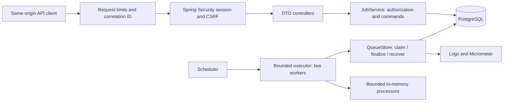
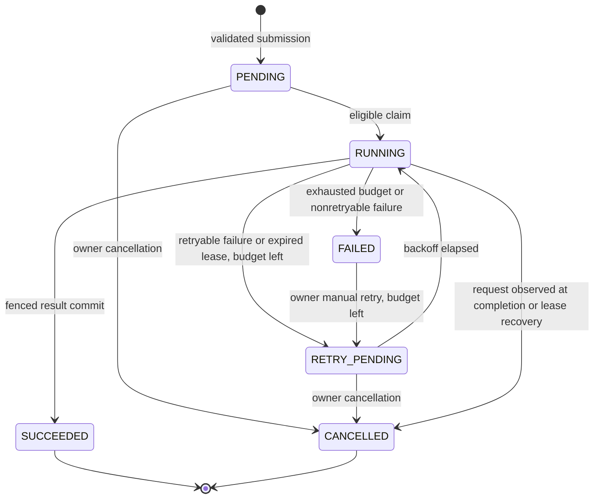
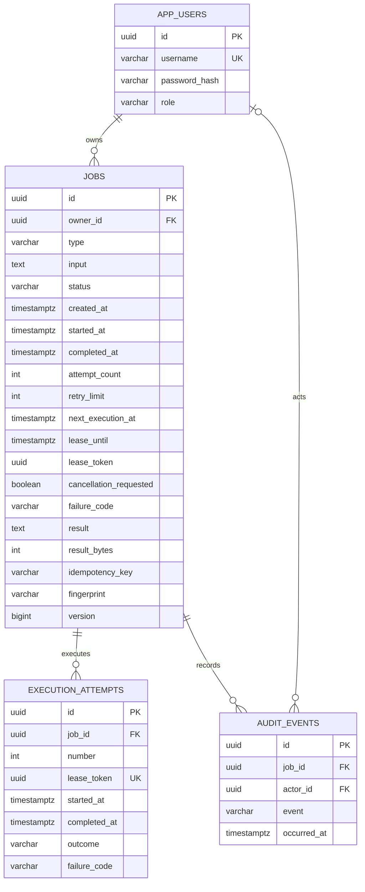

# Architecture

One Spring Boot process contains HTTP endpoints, authentication, job lifecycle services, a scheduler, and a two-thread executor. PostgreSQL stores both the queue and its results. Each package is a module boundary within the monolith; there are no remote module calls.

`auth` models users and provisions passwords interactively. `jobs` owns job requests, lifecycle commands, queue transactions, DTOs, and processors. `web` owns cross-cutting limits, error responses, correlation IDs, and OpenAPI metadata. Spring Data JPA handles users, job reads, row locks, version checks, and lifecycle updates. Small explicit JDBC statements handle conflict-safe insertion and append/update of attempt and audit rows. JDBC uses the same Spring-managed datasource and transaction as JPA. Database entities never cross the HTTP boundary.

## State machine

RUNNING cancellation first sets `cancellation_requested`; HTTP returns 202. The worker stops at a checkpoint, or finalization notices the flag. A cancellation that locks the row after a success commit gets 409. Repeating cancellation on CANCELLED is a successful no-op. SUCCEEDED and FAILED reject cancellation. Cancelled jobs cannot be retried.

`retryLimit` is the number of extra executions, not the total. Allowed values 0-3 give at most 1-4 attempts. Backoff after failed attempt `n` is `min(60, 5 * 2^(n-1))` seconds: 5, 10, 20 for the reachable retry budget. No jitter keeps this small local system predictable. Manual retry requires FAILED with unused budget, schedules the same backoff, and does not reset attempt count. It may be useful after a processor bug is fixed; deterministic invalid input is not made valid by retrying. Normal transient failures are already automatically RETRY_PENDING.

## Transactions and locking

| Operation | Transaction boundary and isolation |
| --- | --- |
| Submit | PostgreSQL READ COMMITTED. Normalize typed DTO, hash SHA-256, `INSERT ... ON CONFLICT(owner_id,idempotency_key) DO NOTHING`, then select the persisted job. Add audit in the same transaction. Concurrent inserts wait for the uniqueness winner; their following select observes its commit. A conflicting fingerprint returns 409. |
| Claim | Select one eligible job ordered by due time, creation and ID, `FOR UPDATE SKIP LOCKED`; set RUNNING, increment count, generate fresh token and 30-second lease, insert attempt and audit, commit. A locked row is skipped, never handed to both workers. |
| Execute | **No surrounding database transaction.** Generate/parse the bounded synthetic CSV or validate up to 100 records in memory. Five-second cooperative deadline, interruption/cancellation checkpoints. Cancellation checks are short separate read transactions, throttled to at most one per 100 ms. |
| Complete | Lock job row, verify RUNNING, token equality and unexpired lease. Recheck cancellation and deadline. Save result and metadata or failure transition, finalize attempt, append audit, clear lease; all commit together. |
| Cancel/retry | Lock job row; enforce ownership and current state; change only permitted fields and add audit. No arbitrary status-update endpoint. |
| Recover | Each poll locks up to 20 expired RUNNING rows with SKIP LOCKED; marks attempts ABANDONED and transitions each job to retry, failed or cancelled. Clear tokens and leases atomically. |

Jobs use JPA `@Version` as an additional guard against accidental stale entity updates. All current lifecycle writes also take row locks. A successful transaction is the point of visibility; an exception rolls back job, attempt and audit together. No result file or external write exists outside that transaction. Claiming happens inside an available executor thread, so leases do not age in a work queue. Two threads plus a `SynchronousQueue` and rejection policy bound local concurrency; a full executor rejects polling tasks until a later poll.

Five-second database transaction/query limits bound normal database operations. A stalled JVM can outlive the execution deadline; expired-lease fencing, rather than an unsafe forced thread kill, prevents its stale completion from publishing a result. JVM/process termination and database outages remain possible; recovery runs on subsequent polls after connectivity returns.

## Relational model

The authoritative schema is [V1 migration](../src/main/resources/db/migration/V1__initial_schema.sql). Constraints bound attempts/retries, valid statuses/types/roles, inputs/results, terminal timestamps, active leases and success results. Unique `(owner_id,idempotency_key)` prevents duplicate submissions; unique `(job_id,number)` prevents duplicate attempt numbering. The owner/time index serves user listings; admin time index serves global listings; partial due-time and lease indexes serve claiming and recovery without indexing terminal rows. Attempt uniqueness starts with job ID and supports ordered attempt retrieval. Audit has a job/time index. Foreign keys prevent orphan rows.

Input/result are bounded JSON stored as text, treated as immutable input and one terminal result. They have no public arbitrary-query requirement, so JSONB indexes are unnecessary. `startedAt` records the latest attempt start; attempts preserve full execution history. `completedAt` is null while active; `nextExecutionAt` is meaningful for eligible states. Active lease tokens are internal and never included in DTOs.
